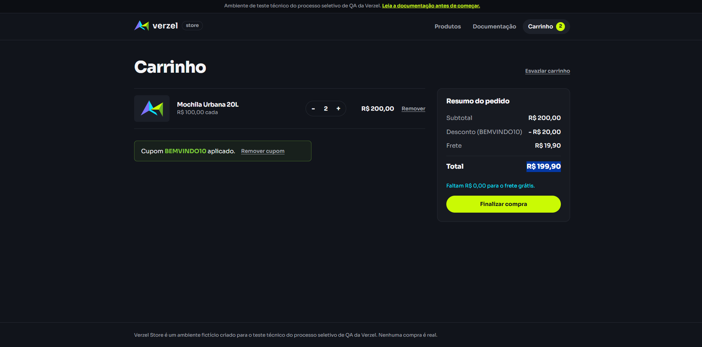

## BUG-001: Frete cobrado com subtotal de R$ 200,00 após aplicar o cupom BEMVINDO10

**Título:**
`Frete de R$ 19,90 é cobrado quando o subtotal é exatamente R$ 200,00 e o cupom BEMVINDO10 está aplicado`

**Descrição:**
`Com o carrinho em R$ 200,00 (2 × Mochila Urbana 20L, P005), o frete grátis deveria valer, pois a regra é "a partir de R$ 200,00, inclusive" (CA06) e considera o subtotal antes do desconto do cupom (CA08). Ao aplicar o cupom BEMVINDO10, o frete passa a ser cobrado (R$ 19,90). A causa provável é que o frete grátis está sendo avaliado sobre o valor já descontado (R$ 180,00, abaixo do limite).`

**Ambiente:**
- Aplicação: Verzel Store, versão 2.3.0 (card VZS-142)
- URL: https://verzel-store.qa-test-verzel-store.workers.dev
- Navegador: Google Chrome
- Sistema operacional: Windows Pro 

**Passo a passo:**

1. Acessar a página de Produtos.
2. Adicionar 2 unidades de "Mochila Urbana 20L" (P005, R$ 100,00) ao carrinho.
3. Acessar o carrinho e confirmar subtotal de R$ 200,00.
4. Aplicar o cupom "BEMVINDO10".
5. Conferir o resumo do pedido.

**Resultado esperado:**
- Desconto: R$ 20,00
- Frete: R$ 0,00 (frete grátis)
- Total: R$ 180,00

**Resultado obtido:**
- Frete exibido: **R$ 19,90**
- Desconto exibido: **R$ 20,00**
- Total exibido: **R$ 199,90** 

**Impacto:**
- **Severidade sugerida: Alta.** `Viola CA06 e CA08, e o cliente é cobrado indevidamente em R$ 19,90.

**Evidência:**

