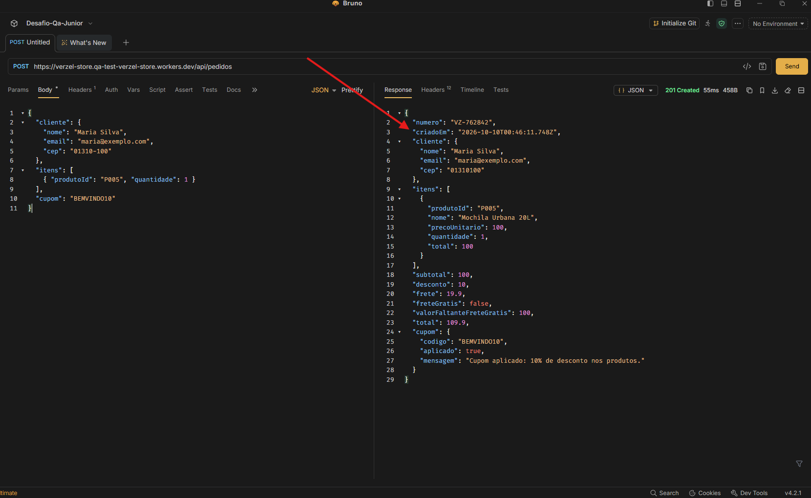

## BUG-002: Campo "criadoEm" do pedido retorna data e hora incorretas

**Título:**
`POST /api/pedidos` retorna data/hora incorreta no campo "criadoEm"

**Descrição:**
Ao confirmar um pedido válido, a resposta 201 traz o campo `criadoEm` com uma data e hora que não correspondem ao momento da requisição. Pela documentação, o campo deve conter o instante de criação do pedido em formato ISO 8601 (ex.: `2026-09-30T14:22:05.120Z`).

**Ambiente:**
- Aplicação: Verzel Store, versão 2.3.0 (card VZS-142)
- URL: https://verzel-store.qa-test-verzel-store.workers.dev
- Navegador: Google Chrome
- Sistema operacional: Windows Pro 

**Passo a passo:**
1. Enviar `POST /api/pedidos` com o cabeçalho `Content-Type: application/json` e o corpo:
   ```json
   {
     "cliente": {
       "nome": "Maria Silva",
       "email": "maria@exemplo.com",
       "cep": "01310-100"
     },
     "itens": [
       { "produtoId": "P005", "quantidade": 1 }
     ],
     "cupom": "BEMVINDO10"
   }
   ```
2. Anotar a data e hora do envio.
3. Conferir o campo `criadoEm` na resposta.

**Resultado esperado:**
- Status 201
- `criadoEm` com a data e hora atuais da requisição, em ISO 8601 (UTC), por exemplo `2026-10-08T14:22:05.120Z`
- `desconto` = 10, `frete` = 19.9, `total` = 109.9, `numero` no formato `VZ-000000`

**Resultado obtido:**
- A data/hora não corresponde ao momento do envio 

**Impacto:**
- **Severidade sugerida: Média.** Os valores financeiros não são afetados, mas o horário de criação do pedido é um dado de rastreabilidade e auditoria.

**Evidência:**


