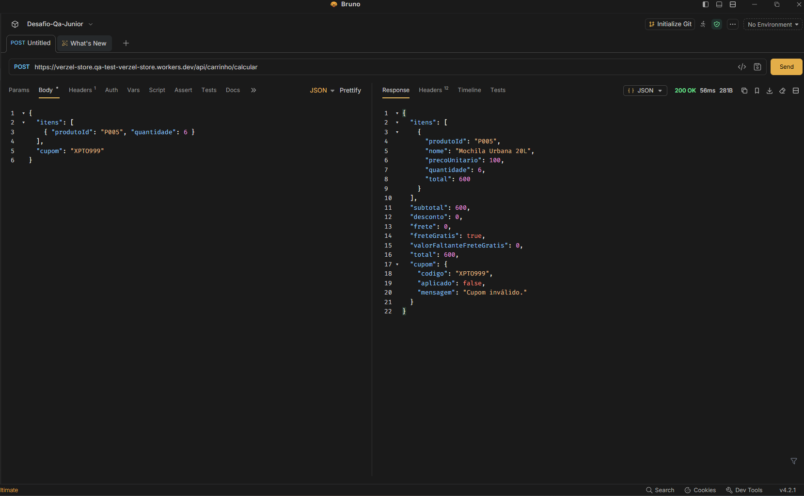

## BUG-003: API aceita mais de 5 unidades por produto

**Título:**
`POST /api/carrinho/calcular` não valida o limite de 5 unidades por produto (o bloqueio existe só na interface)

**Descrição:**
O CA10 define o máximo de 5 unidades por produto e diz que a regra vale para a **interface e para a API**. A interface bloqueia a adição de mais de 5 unidades, mas a API processa normalmente uma requisição com 6 unidades, em vez de rejeitá-la com `QUANTIDADE_MAXIMA_EXCEDIDA`. Isso permite burlar a regra chamando a API diretamente. O problema foi observado com cupom inexistente (`XPTO999`) e também com cupom válido, o que indica que a validação não depende do cupom.

**Ambiente:**
- Aplicação: Verzel Store, versão 2.3.0 (card VZS-142)
- URL: https://verzel-store.qa-test-verzel-store.workers.dev
- Navegador: Google Chrome
- Sistema operacional: Windows Pro 

**Passo a passo:**
1. Enviar `POST /api/carrinho/calcular` com `Content-Type: application/json` e o corpo:
   ```json
   {
     "itens": [
       { "produtoId": "P005", "quantidade": 6 }
     ],
     "cupom": "XPTO999"
   }
   ```
2. Conferir o status e o corpo da resposta.
3. Repetir o passo 1 com `"cupom": "BEMVINDO10"` e sem o campo `cupom`.

**Resultado esperado:**
- Status 422
- Corpo no formato de erro da documentação:
  ```json
  {
    "erro": {
      "codigo": "QUANTIDADE_MAXIMA_EXCEDIDA",
      "mensagem": "...",
      "campo": "itens[0].quantidade"
    }
  }
  ```

**Resultado obtido:**
- A API **não rejeitou** a requisição e processou o cálculo com 6 unidades.

**Impacto:**
- **Severidade sugerida: alta.** Descumpre o CA10 e o contrato de erros da API, e qualquer cliente que chame a API diretamente consegue contornar a regra de negócio.

**Evidência:**



