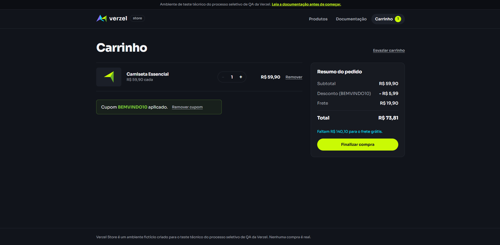
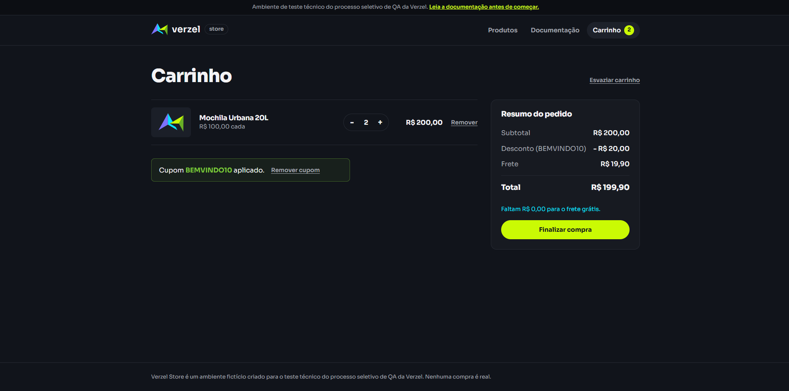
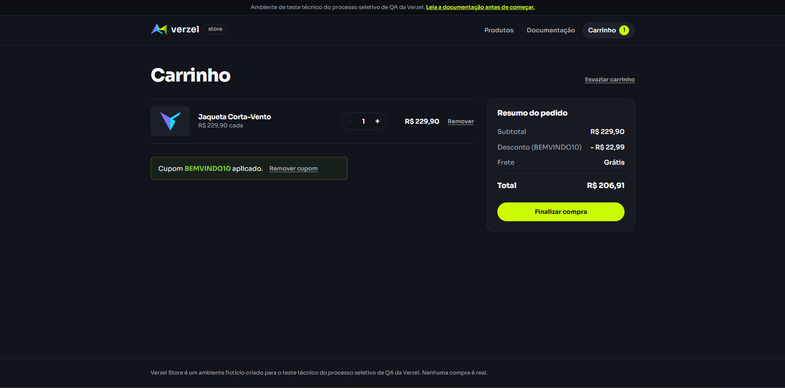
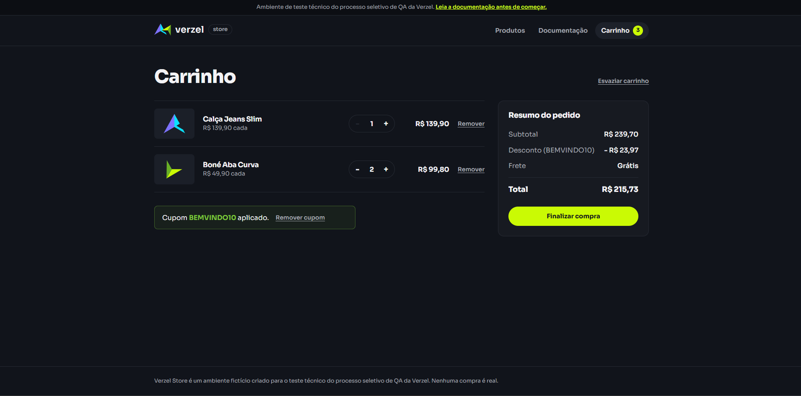
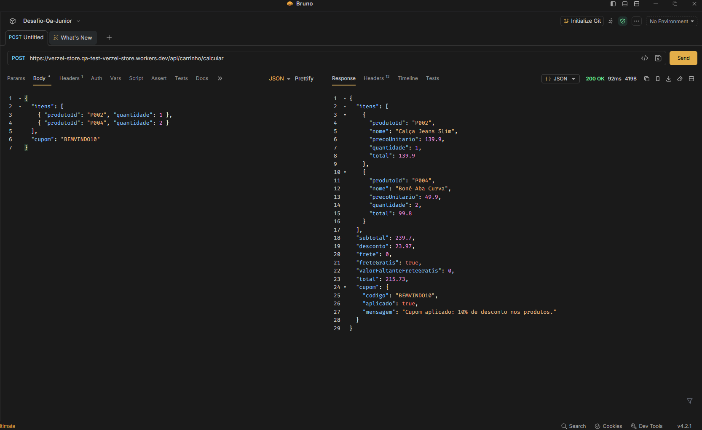
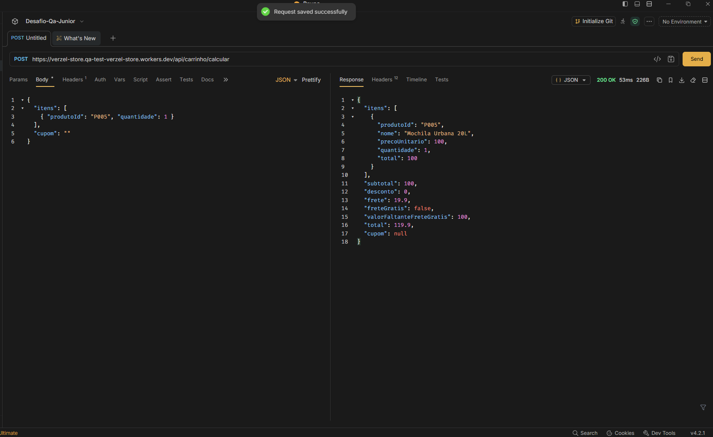
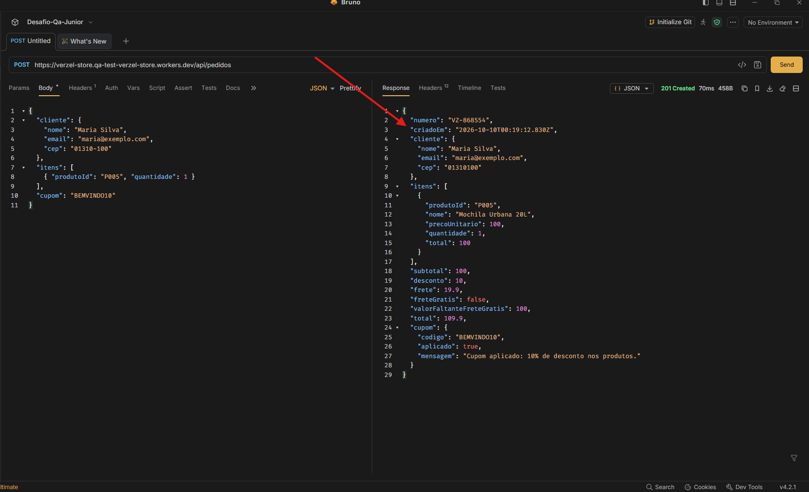
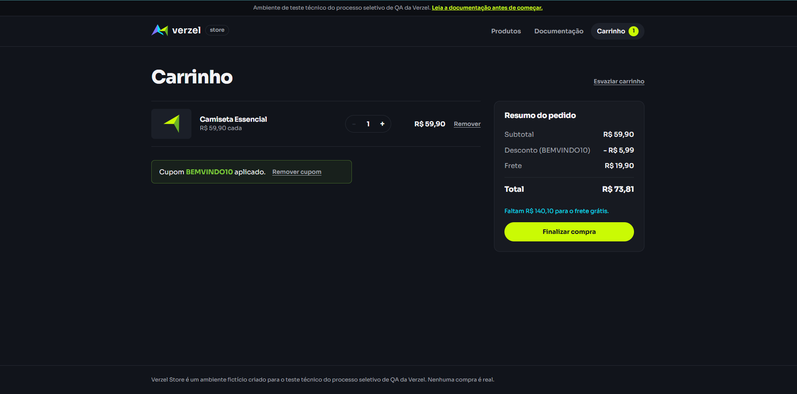

# Cenários de Teste: CA01 (Cupom BEMVINDO10)

**Card:** VZS-142 | **Versão:** 2.3.0

**Critério de aceite:** CA01. O cupom BEMVINDO10 aplica 10% de desconto sobre o subtotal dos produtos.

---

## Premissas e regras de cálculo

- `subtotal = soma de (preço unitário × quantidade)`
- `desconto = 10% do subtotal` (nunca incide sobre o frete)
- `frete = R$ 0,00 se subtotal >= R$ 200,00, senão R$ 19,90` (regra baseada no subtotal antes do desconto)
- `total = subtotal - desconto + frete`
- A API faz os cálculos e a interface apenas exibe o resultado.
- Tags: **[UI]** interface, **[API]** requisição direta à API.
- Os cenários CT001 a CT016 mantêm a numeração da suíte completa. Os cenários adicionais deste critério continuam a partir de **CT197**.

### Massa de dados

| Produto | Id | Preço |
|---|---|---|
| Camiseta Essencial | P001 | R$ 59,90 |
| Calça Jeans Slim | P002 | R$ 139,90 |
| Tênis Casual Urbano | P003 | R$ 189,90 |
| Boné Aba Curva | P004 | R$ 49,90 |
| Mochila Urbana 20L | P005 | R$ 100,00 |
| Kit 3 Pares de Meias | P006 | R$ 29,90 |
| Jaqueta Corta-Vento | P007 | R$ 229,90 |
| Garrafa Térmica 750ml | P008 | R$ 50,00 |

| Cupom | Desconto | Situação |
|---|---|---|
| BEMVINDO10 | 10% | Válido |

---

## 1. Aplicação do desconto na interface

### CT001: Cupom com subtotal abaixo de R$ 200,00 [UI]
```gherkin
Dado que o carrinho possui 1 unidade de Camiseta Essencial(P001) (subtotal R$ 59,90)
Quando o cliente aplica o cupom "BEMVINDO10"
Então o desconto exibido é R$ 5,99
E o frete é R$ 19,90
E o total é R$ 73,81
```
**Resultado**: Aprovado
**Evidência**:


### CT002: Cupom com subtotal exatamente R$ 200,00 [UI]
```gherkin
Dado que o carrinho possui 2 unidades de Mochila Urbana 20L(P005) (subtotal R$ 200,00)
Quando o cliente aplica o cupom "BEMVINDO10"
Então o desconto exibido é R$ 20,00
E o frete é R$ 0,00
E o total é R$ 180,00
```
**Resultado**: Reprovado
**Motivo**: `O frete deveria ser R$0,00, porém exibe R$ 19,90`
**Evidência**:


### CT003: Cupom com subtotal acima de R$ 200,00 [UI]
```gherkin
Dado que o carrinho possui 1 unidade de Jaqueta Corta-Vento(P007) (subtotal R$ 229,90)
Quando o cliente aplica o cupom "BEMVINDO10"
Então o desconto exibido é R$ 22,99
E o frete é R$ 0,00
E o total é R$ 206,91
```

**Resultado**: Aprovado
**Dúvida**: `O frete deveria aparecer como R$0,00 ou como "Grátis" ?`
**Evidência**:


### CT004: Cupom com múltiplos produtos, exemplo da documentação [UI]
```gherkin
Dado que o carrinho possui 1 unidade de Calça Jeans Slim(P002) e 2 unidades de Boné Aba Curva(P004) (subtotal R$ 239,70)
Quando o cliente aplica o cupom "BEMVINDO10"
Então o desconto exibido é R$ 23,97
E o frete é R$ 0,00
E o total é R$ 215,73
```
**Resultado**: Aprovado
**Dúvida**: `O frete deveria aparecer como R$0,00 ou como "Grátis" ?`
**Evidência**:


---

## 2. Aplicação do desconto na API

### CT005: Resposta completa da API com cupom válido [API]
```gherkin
Dado uma requisição POST em "/api/carrinho/calcular" com Calça Jeans Slim(P002) x1, Boné Aba Curva(P004) x2 e cupom "BEMVINDO10"
Quando a API processa a requisição
Então o status da resposta é 200
E "subtotal" é 239.7
E "desconto" é 23.97
E "frete" é 0
E "freteGratis" é true
E "valorFaltanteFreteGratis" é 0
E "total" é 215.73
E "cupom.codigo" é "BEMVINDO10"
E "cupom.aplicado" é true
E "cupom.mensagem" é "Cupom aplicado: 10% de desconto nos produtos."
```
**Resultado**: Aprovado
**Evidência**:


### CT006: Cálculo sem cupom [API]
```gherkin
Dado uma requisição POST em "/api/carrinho/calcular" com Mochila Urbana 20L(P005) x1 e sem o campo "cupom"
Quando a API processa a requisição
Então o status da resposta é 200
E "desconto" é 0
E "frete" é 19.9
E "total" é 119.9
E o objeto "cupom" não indica desconto aplicado
```
**Resultado**: Aprovado
**Evidência**:


### CT007: Pedido com cupom válido [API]
```gherkin
Dado um pedido com cliente válido, P005 x1 e cupom "BEMVINDO10"
Quando a requisição POST em "/api/pedidos" é enviada
Então o status da resposta é 201
E "desconto" é 10
E "frete" é 19.9
E "total" é 109.9
E "numero" segue o formato "VZ-000000"
```
**Resultado**: Reprovado
**Motivo**: `O campo "criadoEm" está retornando uma data incorreta, deveria retornar a data e hora atuais`
**Evidência**:


---

## 3. Recálculo do desconto ao alterar o carrinho

### CT008: Aumentar a quantidade com cupom aplicado [UI]
```gherkin
Dado que o carrinho possui 1 unidade de P005 com o cupom "BEMVINDO10" aplicado
Quando o cliente aumenta a quantidade de P005 para 2
Então o desconto passa a ser R$ 20,00
E o frete passa a ser R$ 0,00
E o total passa a ser R$ 180,00
```
**Resultado**: Reprovado
**Motivo**: `O frete deveria ser R$ 0,00. porém exibe R$ 19,90`
**Evidência**:


### CT009: Reduzir a quantidade com cupom aplicado [UI]
```gherkin
Dado que o carrinho possui 2 unidades de P005 com o cupom "BEMVINDO10" aplicado
Quando o cliente reduz a quantidade de P005 para 1
Então o desconto passa a ser R$ 10,00
E o frete passa a ser R$ 19,90
E o total passa a ser R$ 109,90
```
**Resultado**: Aprovado
**Evidência**:


### CT010: Remover um produto com cupom aplicado [UI]
```gherkin
Dado que o carrinho possui P007 e P001 com o cupom "BEMVINDO10" aplicado
Quando o cliente remove P007 do carrinho
Então o subtotal passa a ser R$ 59,90
E o desconto passa a ser R$ 5,99
E o frete passa a ser R$ 19,90
E o total passa a ser R$ 73,81
```
**Resultado**: Aprovado
**Evidência**:


---
