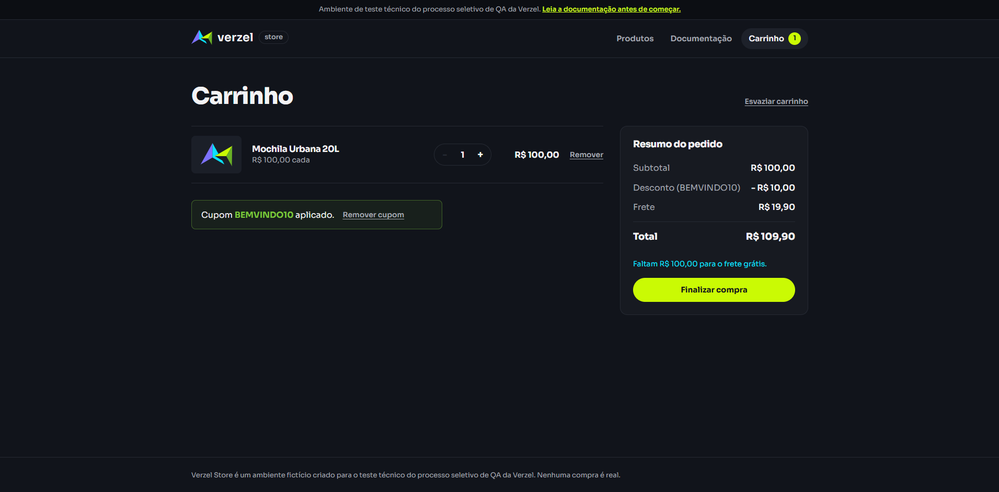
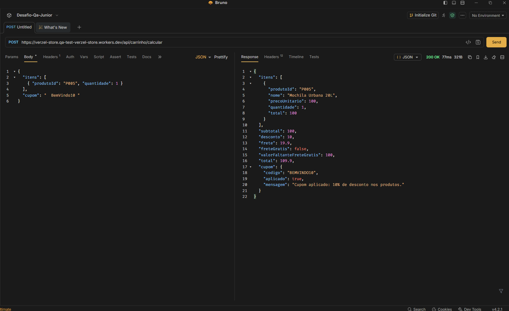
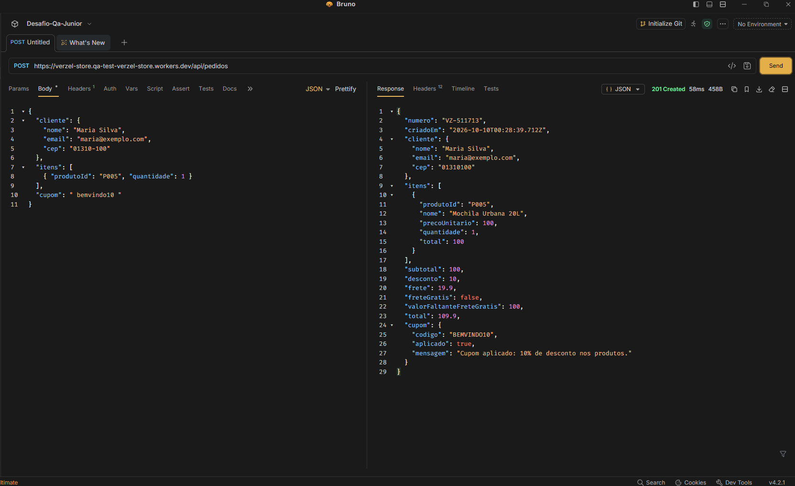
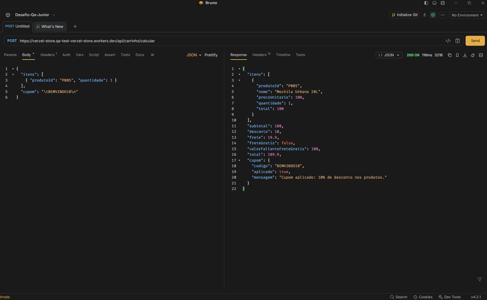
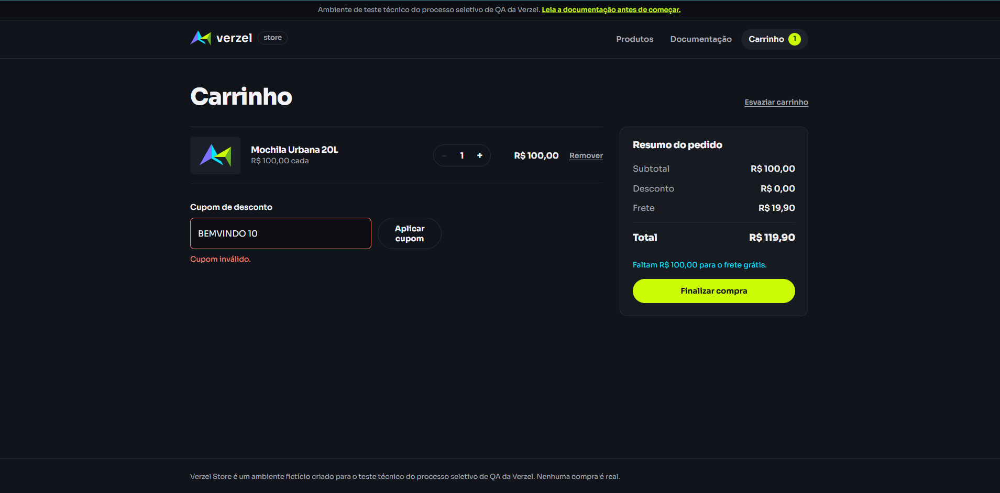
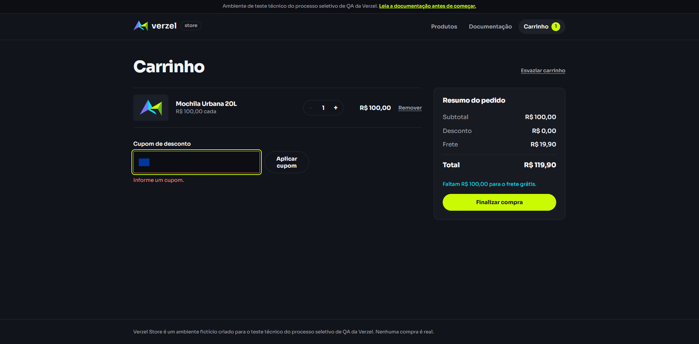

# Cenários de Teste: CA02 (Maiúsculas/minúsculas e espaços nas pontas)

**Card:** VZS-142 | **Versão:** 2.3.0

**Critério de aceite:** CA02. O código do cupom não diferencia maiúsculas de minúsculas, e espaços no início e no fim são ignorados.

---

## Premissas e regras

- O código do cupom é comparado sem diferenciar maiúsculas de minúsculas.
- Espaços no **início** e no **fim** do código são ignorados (trim).
- Espaços **no meio** do código não são ignorados, então tornam o código inválido.
- Cupom inexistente: mensagem "Cupom inválido." Cupom expirado: mensagem "Cupom expirado."
- `POST /api/carrinho/calcular` devolve **200** com `cupom.aplicado = false` e o motivo em `cupom.mensagem`, mesmo para cupom inválido ou expirado.
- `POST /api/pedidos` devolve **422** com `CUPOM_INVALIDO` ou `CUPOM_EXPIRADO`.
- Tags: **[UI]** interface, **[API]** requisição direta à API.
- Os cenários CT017 a CT036 mantêm a numeração da suíte completa. Os cenários adicionais deste critério continuam a partir de **CT211**.

### Massa de dados

| Item | Valor |
|---|---|
| Produto base | P005, Mochila Urbana 20L, R$ 100,00 |
| Cupom válido | BEMVINDO10 (10%) |
| Cupom expirado | VERAO2026 (15%, expirou em 31/03/2026) |
| Cupom inexistente | XPTO999 |

Resultado esperado com P005 x1 e cupom válido: desconto **R$ 10,00**, frete **R$ 19,90**, total **R$ 109,90**.
Resultado esperado sem desconto: desconto **R$ 0,00**, frete **R$ 19,90**, total **R$ 119,90**.

---

## 1. Maiúsculas e minúsculas

### CT001: Cupom em minúsculas [UI]
```gherkin
Dado que o carrinho possui 1 unidade de P005
Quando o cliente aplica o cupom "bemvindo10"
Então o desconto de R$ 10,00 é aplicado
E o total é R$ 109,90
```
**Resultado**: Aprovado
**Evidência**:


### CT002: Cupom com capitalização mista [UI]
```gherkin
Dado que o carrinho possui 1 unidade de P005
Quando o cliente aplica o cupom "BemVindo10"
Então o desconto de R$ 10,00 é aplicado
E o total é R$ 109,90
```
**Resultado**: Aprovado
**Evidência**:


## 2. Espaços no início e no fim (interface)

### CT003: Espaços no início [UI]
```gherkin
Dado que o carrinho possui 1 unidade de P005
Quando o cliente aplica o cupom "   BEMVINDO10"
Então o desconto de R$ 10,00 é aplicado
```
**Resultado**: Aprovado
**Evidência**:


### CT004: Espaços no fim [UI]
```gherkin
Dado que o carrinho possui 1 unidade de P005
Quando o cliente aplica o cupom "BEMVINDO10   "
Então o desconto de R$ 10,00 é aplicado
```
**Resultado**: Aprovado
**Evidência**:


### CT005: Espaços no início e no fim com caixa mista [UI]
```gherkin
Dado que o carrinho possui 1 unidade de P005
Quando o cliente aplica o cupom "  bemvindo10  "
Então o desconto de R$ 10,00 é aplicado
```
**Resultado**: Aprovado
**Evidência**:


---

## 3. Case-insensitive e trim via API

### CT006: Cálculo com caixa mista e espaços [API]
```gherkin
Dado uma requisição POST em "/api/carrinho/calcular" com P005 x1 e cupom "  BemVindo10 "
Quando a API processa a requisição
Então o status da resposta é 200
E "cupom.aplicado" é true
E "desconto" é 10
E "total" é 109.9
```
**Resultado**: Aprovado
**Evidência**:


### CT007: Pedido com caixa mista e espaços [API]
```gherkin
Dado um pedido válido com P005 x1 e cupom " bemvindo10 "
Quando a requisição POST em "/api/pedidos" é enviada
Então o status da resposta é 201
E "desconto" é 10
E "total" é 109.9
```
**Resultado**: Aprovado
**Evidência**:


### CT008: Tabulação ou quebra de linha nas pontas [API]
```gherkin
Dado uma requisição POST em "/api/carrinho/calcular" com P005 x1 e cupom "\tBEMVINDO10\n"
Quando a API processa a requisição
Então o tratamento é consistente com o de espaços (aplicado ou rejeitado de forma padronizada)
E a API não responde com erro 500
```
**Resultado**: Aprovado
**Evidência**:


---

## 4. Espaços internos e campo vazio

### CT009: Espaço no meio do código [UI]
```gherkin
Dado que o carrinho possui 1 unidade de P005
Quando o cliente aplica o cupom "BEMVINDO 10"
Então a mensagem "Cupom inválido." é exibida
E nenhum desconto é aplicado
```
**Resultado**: Aprovado
**Evidência**:


### CT010: Apenas espaços [UI]
```gherkin
Dado que o carrinho possui 1 unidade de P005
Quando o cliente informa somente espaços no campo de cupom e tenta aplicar
Então nenhum desconto é aplicado
E o tratamento é o mesmo de campo vazio, sem erro técnico
```
**Resultado**: Aprovado
**Evidência**:

