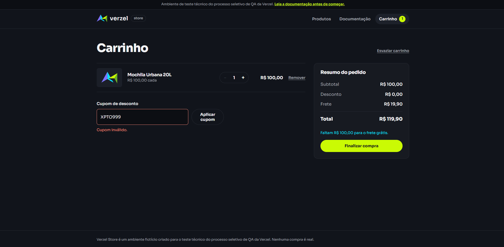
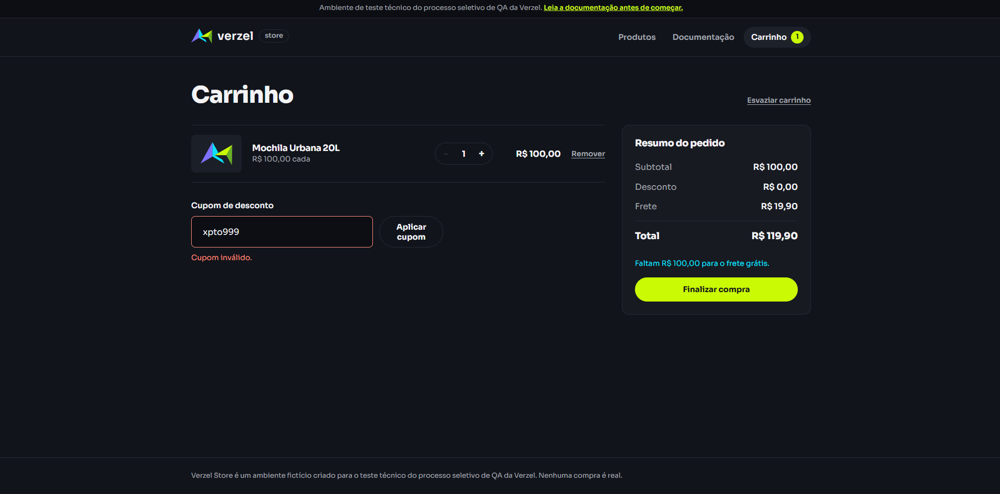
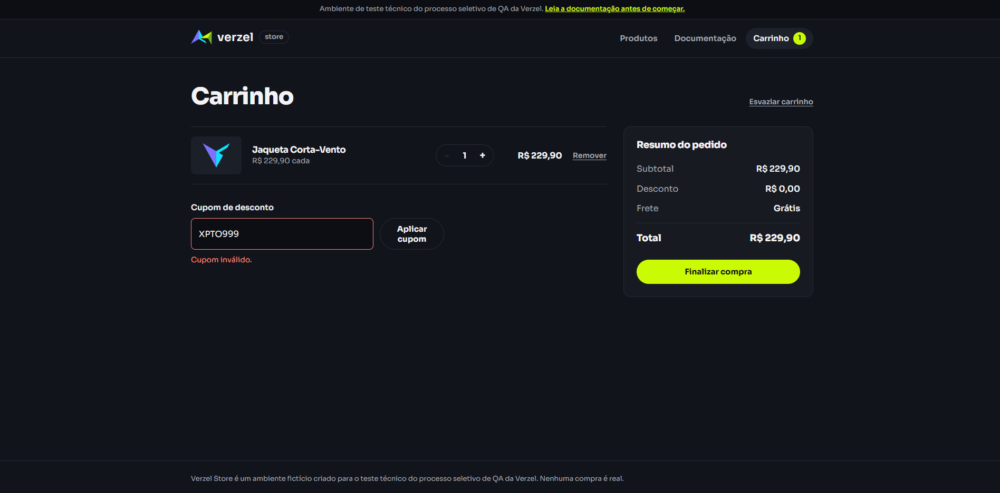
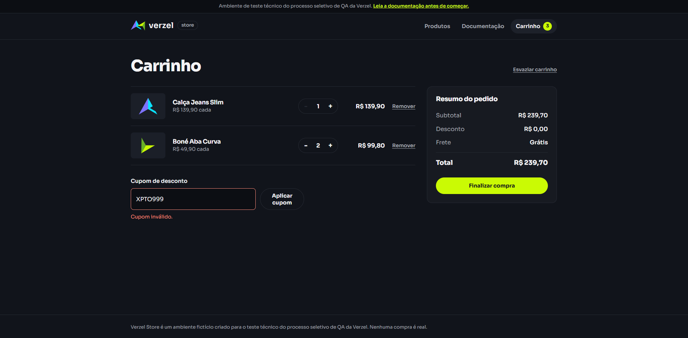

# Cenários de Teste: CA03 (Cupom inexistente)

**Card:** VZS-142 | **Versão:** 2.3.0

**Critério de aceite:** CA03. Um cupom inexistente exibe a mensagem "Cupom inválido." e nenhum desconto é aplicado.

---

## Premissas e regras

- Cupom inexistente é qualquer código diferente de `BEMVINDO10` (válido) e `VERAO2026` (expirado). Código de apoio usado nos testes: `XPTO999`.
- Mensagem esperada: exatamente **"Cupom inválido."** (com acento e ponto final).
- `POST /api/carrinho/calcular` devolve **200** com `cupom.aplicado = false` e o motivo em `cupom.mensagem`, sem gerar erro.
- `POST /api/pedidos` devolve **422** com `CUPOM_INVALIDO`.
- Sem cupom válido, `desconto = 0` e `total = subtotal + frete`.
- O frete segue o subtotal: R$ 0,00 a partir de R$ 200,00, senão R$ 19,90.
- Tags: **[UI]** interface, **[API]** requisição direta à API.
- Os cenários CT037 a CT044 mantêm a numeração da suíte completa. Os cenários adicionais deste critério continuam a partir de **CT232**.

### Massa de dados

| Item | Valor |
|---|---|
| Produto base | P005, Mochila Urbana 20L, R$ 100,00 |
| Cupom inexistente | XPTO999 |
| Cupom válido | BEMVINDO10 (10%) |
| Cupom expirado | VERAO2026 (15%, expirou em 31/03/2026) |

Resultado esperado com P005 x1 e cupom inexistente: desconto **R$ 0,00**, frete **R$ 19,90**, total **R$ 119,90**.

---

## 1. Cupom inexistente na interface

### CT001: Cupom inexistente [UI]
```gherkin
Dado que o carrinho possui 1 unidade de P005
Quando o cliente aplica o cupom "XPTO999"
Então a mensagem "Cupom inválido." é exibida
E o desconto é R$ 0,00
E o total é R$ 119,90
```
**Resultado**: Aprovado
**Evidência**:


### CT002: Cupom inexistente com variação de caixa e espaços [UI]
```gherkin
Dado que o carrinho possui 1 unidade de P005
Quando o cliente aplica o cupom "  xpto999  "
Então a mensagem "Cupom inválido." é exibida
E nenhum desconto é aplicado
```
**Resultado**: Aprovado
**Evidência**:



### CT003: Cupom inexistente com subtotal abaixo de R$ 200,00 [UI]
```gherkin
Dado que o carrinho possui 1 unidade de P001 (subtotal R$ 59,90)
Quando o cliente aplica o cupom "XPTO999"
Então a mensagem "Cupom inválido." é exibida
E o desconto é R$ 0,00
E o frete é R$ 19,90
E o total é R$ 79,80
```
**Resultado**: Aprovado
**Evidência**:


### CT004: Cupom inexistente com subtotal acima de R$ 200,00 [UI]
```gherkin
Dado que o carrinho possui 1 unidade de P007 (subtotal R$ 229,90)
Quando o cliente aplica o cupom "XPTO999"
Então a mensagem "Cupom inválido." é exibida
E o desconto é R$ 0,00
E o frete é R$ 0,00
E o total é R$ 229,90
```
**Resultado**: Aprovado
**Evidência**:


### CT005: Cupom inexistente com múltiplos produtos [UI]
```gherkin
Dado que o carrinho possui 1 unidade de P002 e 2 unidades de P004 (subtotal R$ 239,70)
Quando o cliente aplica o cupom "XPTO999"
Então a mensagem "Cupom inválido." é exibida
E o desconto é R$ 0,00
E o frete é R$ 0,00
E o total é R$ 239,70
```
**Resultado**: Aprovado
**Evidência**:


---

## 2. Nenhum efeito no carrinho

### CT006: Cupom inexistente não altera o frete grátis [UI]
```gherkin
Dado que o carrinho possui 2 unidades de P005 (subtotal R$ 200,00)
Quando o cliente aplica o cupom "XPTO999"
Então a mensagem "Cupom inválido." é exibida
E o frete continua R$ 0,00
E o total continua R$ 200,00
```
**Resultado**: Reprovado
**Motivo**: `O frete deveria ser R$ 0,00, porém exibe R$ 19,90`
**Evidência**:


### CT007: Resumo sem desconto e sem cupom ativo [UI]
```gherkin
Dado que o carrinho possui 1 unidade de P005
Quando o cliente aplica o cupom "XPTO999"
Então o resumo não exibe desconto (ou exibe R$ 0,00)
E o código "XPTO999" não aparece como cupom ativo
E a opção de remover cupom não é exibida
```
**Resultado**: Aprovado
**Evidência**:


### CT008: Campo continua disponível para nova tentativa [UI]
```gherkin
Dado que o cliente aplicou o cupom "XPTO999" e recebeu "Cupom inválido."
Quando o cliente digita "BEMVINDO10" no campo de cupom e clica em "Aplicar"
Então o campo está habilitado para a nova tentativa
E o desconto de R$ 10,00 é aplicado
```
**Resultado**: Aprovado
**Evidência**:


### CT009: Valor faltante para o frete grátis não é alterado [UI]
```gherkin
Dado que o carrinho possui 1 unidade de P003 (subtotal R$ 189,90) e faltam R$ 10,10 para o frete grátis
Quando o cliente aplica o cupom "XPTO999"
Então a mensagem "Cupom inválido." é exibida
E continua sendo informado que faltam R$ 10,10 para o frete grátis
E o total é R$ 209,80
```
**Resultado**: Aprovado
**Evidência**:


---

## 3. Cupom inexistente no cálculo da API

### CT010: Cupom inexistente no cálculo [API]
```gherkin
Dado uma requisição POST em "/api/carrinho/calcular" com P005 x1 e cupom "XPTO999"
Quando a API processa a requisição
Então o status da resposta é 200 (não é erro)
E "cupom.aplicado" é false
E "cupom.mensagem" é "Cupom inválido."
E "desconto" é 0
E "total" é 119.9
```
**Resultado**: Aprovado
**Evidência**:


---

## 4. Cupom inexistente no pedido da API

### CT011: Cupom inexistente com quantidade acima do limite no cálculo [API]
```gherkin
Dado uma requisição POST em "/api/carrinho/calcular" com P005 x6 e cupom "XPTO999"
Quando a API processa a requisição
Então o status da resposta é 422
E "erro.codigo" é "QUANTIDADE_MAXIMA_EXCEDIDA"
```
**Resultado**: Reprovado
**Motivo**: O front bloqueia adicionar mais de 5 unidades por produto, porém o backend permite inserir mais de 5 unidades por produto
**Evidência**:


---

