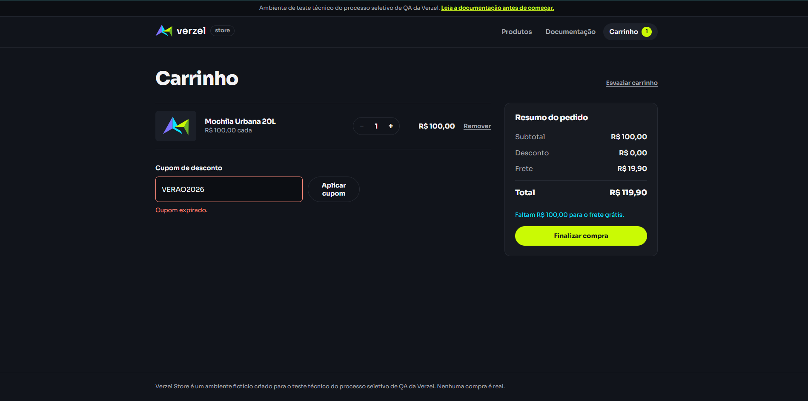
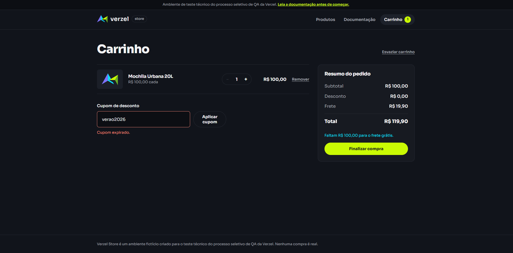
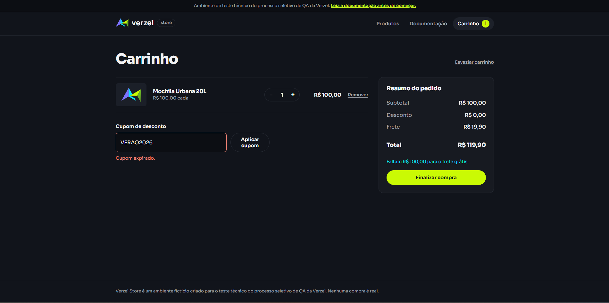
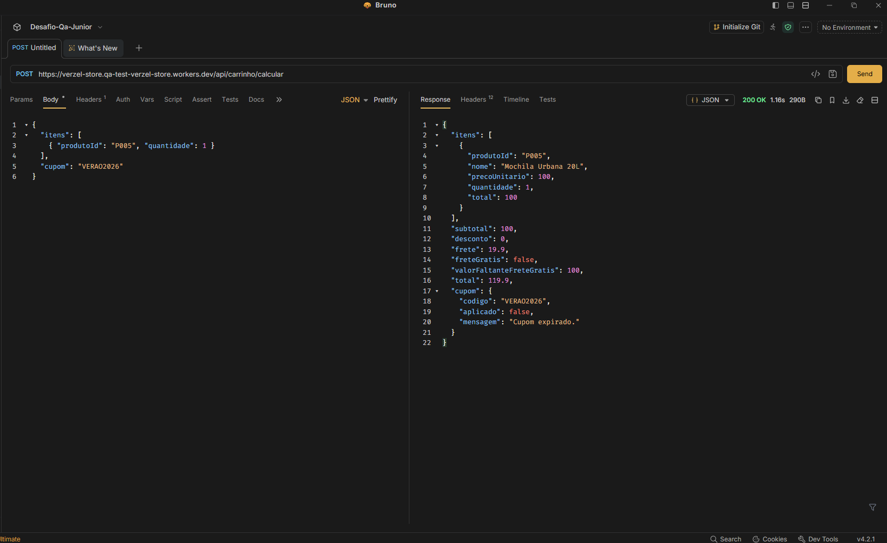
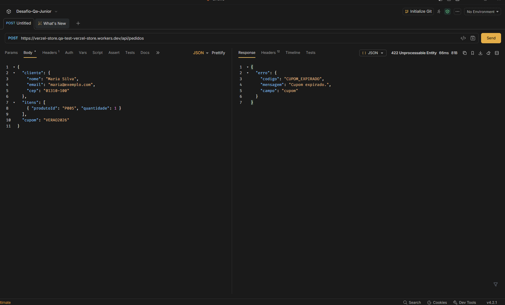

# Cenários de Teste: CA04 (Cupom expirado)

**Card:** VZS-142 | **Versão:** 2.3.0

**Critério de aceite:** CA04. Um cupom fora da validade exibe a mensagem "Cupom expirado." e nenhum desconto é aplicado.

---

## Premissas e regras

- Cupom expirado da massa de dados: `VERAO2026` (15%, expirou em 31/03/2026).
- Mensagem esperada: exatamente **"Cupom expirado."** (com ponto final). Não deve ser confundida com "Cupom inválido.", usada para cupom inexistente.
- `POST /api/carrinho/calcular` devolve **200** com `cupom.aplicado = false` e o motivo em `cupom.mensagem`, sem gerar erro.
- `POST /api/pedidos` devolve **422** com `CUPOM_EXPIRADO`.
- Sem cupom válido, `desconto = 0` e `total = subtotal + frete`.
- O frete segue o subtotal: R$ 0,00 a partir de R$ 200,00, senão R$ 19,90.
- Tags: **[UI]** interface, **[API]** requisição direta à API.
- Os cenários CT045 a CT053 mantêm a numeração da suíte completa. Os cenários adicionais deste critério continuam a partir de **CT254**.
- As variações de caixa e espaços aplicadas ao cupom expirado em API (CT223 e CT224) estão no arquivo do CA02.

### Massa de dados

| Item | Valor |
|---|---|
| Produto base | P005, Mochila Urbana 20L, R$ 100,00 |
| Cupom expirado | VERAO2026 (15%, expirou em 31/03/2026) |
| Cupom válido | BEMVINDO10 (10%) |
| Cupom inexistente | XPTO999 |

Resultado esperado com P005 x1 e cupom expirado: desconto **R$ 0,00**, frete **R$ 19,90**, total **R$ 119,90**.

---

## 1. Cupom expirado na interface

### CT001: Cupom expirado [UI]
```gherkin
Dado que o carrinho possui 1 unidade de P005
Quando o cliente aplica o cupom "VERAO2026"
Então a mensagem "Cupom expirado." é exibida
E nenhum desconto é aplicado
E o total é R$ 119,90
```
**Resultado**: Aprovado
**Evidência**:


### CT002: Cupom expirado com variação de caixa e espaços [UI]
```gherkin
Dado que o carrinho possui 1 unidade de P005
Quando o cliente aplica o cupom " verao2026 "
Então a mensagem "Cupom expirado." é exibida (e não "Cupom inválido.")
```
**Resultado**: Aprovado
**Evidência**:


### CT003: Cupom expirado não aplica o percentual de 15% [UI]
```gherkin
Dado que o carrinho possui 1 unidade de P005 (subtotal R$ 100,00)
Quando o cliente aplica o cupom "VERAO2026"
Então a mensagem "Cupom expirado." é exibida
E o desconto é R$ 0,00 (e não R$ 15,00)
E o frete é R$ 19,90
E o total é R$ 119,90
```
**Resultado**: Aprovado
**Evidência**:


---

## 2. Cupom expirado no cálculo da API

### CT004: Cupom expirado no cálculo [API]
```gherkin
Dado uma requisição POST em "/api/carrinho/calcular" com P005 x1 e cupom "VERAO2026"
Quando a API processa a requisição
Então o status da resposta é 200
E "cupom.aplicado" é false
E "cupom.mensagem" é "Cupom expirado."
E "desconto" é 0
E "total" é 119.9
```
**Resultado**: Aprovado
**Evidência**:


### CT005: Frete grátis preservado com cupom expirado [API]
```gherkin
Dado uma requisição POST em "/api/carrinho/calcular" com P007 x1 e cupom "VERAO2026"
Quando a API processa a requisição
Então o status da resposta é 200
E "desconto" é 0
E "frete" é 0
E "freteGratis" é true
E "valorFaltanteFreteGratis" é 0
E "total" é 229.9
```
**Resultado**: Aprovado
**Evidência**:


---

## 3. Cupom expirado no pedido da API

### CT006: Cupom expirado no pedido [API]
```gherkin
Dado um pedido válido com P005 x1 e cupom "VERAO2026"
Quando a requisição POST em "/api/pedidos" é enviada
Então o status da resposta é 422
E "erro.codigo" é "CUPOM_EXPIRADO"
```
**Resultado**: Aprovado
**Evidência**:


---

